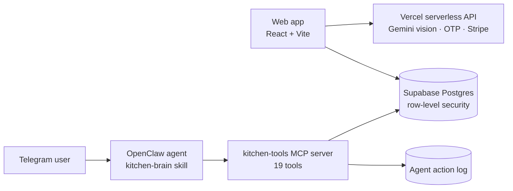

# Smart Kitchen AI

**AI inventory and operations system for multi-store cafés and kitchens.** Supplier invoices and shelf photos go in; structured stock, prep lists, shopping lists and wastage records come out. Kitchen staff can run day-to-day operations from Telegram through an AI agent that works on the same data, with role-based permissions.

**Live app:** https://smart-kitchen-ai.vercel.app

<!-- Add 2–3 screenshots here: dashboard, invoice scan result, Telegram agent conversation -->

## What it does

| Area | Capability |
|---|---|
| Invoice & photo scanning | Gemini vision reads supplier invoices and shelf photos and turns them into structured line items (item, quantity, unit, cost); low-confidence results are highlighted for review |
| Inventory | Stock by location and container, smart unit conversion, reorder suggestions, guided setup wizard with Excel import and reusable templates |
| Kitchen operations | Prep lists, shift scheduling, staff calendar, wastage tracking, menu costing |
| Multi-store | One account manages several stores; staff join a store by code; manager / staff roles |
| Telegram agent | One bot serves every store: staff link their account with a one-time code, then add stock, record wastage, create prep tasks or ask questions in plain language |
| Billing & auth | Email OTP login, Stripe subscription |

## Architecture



### Agent and MCP layer

The `mcp/kitchen-tools` package is a custom MCP server that exposes 19 kitchen tools (inventory, prep, shopping, wastage, receipt import, Kitchen Wiki search) to an AI agent. The agent never touches the database directly:

- every request first resolves who the sender is (`kitchen_resolve_actor`) and which store they may act on;
- manager and staff permissions are enforced in the tool layer and again by database RLS policies;
- high-risk stock changes are restricted to managers;
- every agent action is written to an audit log shown in the web app's activity feed.

The agent's operating rules live in `openclaw/skills/kitchen-brain/SKILL.md`.

## Engineering notes

- **Development:** December 2025 – June 2026, 113 commits
- **Database:** 33 SQL migrations, with row-level security policies for stores, staff and the agent permission model
- **Tests:** 21 Vitest test files covering pages, hooks, invoice vision, MCP permissions, Telegram linking and migrations
- **Security:** Gemini key moved server-side (no API key in the browser bundle); `.gitignore` rules keep secrets and test scripts out of commits
- **Refactoring:** documented state audit and optimisation plan in `docs/`

## Tech stack

React · TypeScript · Vite · Tailwind · Supabase (Postgres, Auth, RLS) · Vercel serverless functions · Google Gemini (vision + text) · Model Context Protocol · OpenClaw · Telegram · Stripe · Vitest

## Run locally

```bash
npm install
npm run dev
npm test
```

Environment variables (set in `.env.local` and in Vercel):

| Variable | Used by |
|---|---|
| `VITE_SUPABASE_URL`, `VITE_SUPABASE_ANON_KEY` | Web client |
| `SUPABASE_URL`, `SUPABASE_SERVICE_ROLE_KEY` | Server API and MCP server only |
| `GEMINI_API_KEY`, `GEMINI_MODEL` | Server API (vision) |
| `STRIPE_SECRET_KEY`, `STRIPE_PRICE_ID_PRO`, `VITE_STRIPE_PUBLISHABLE_KEY` | Subscriptions |
| `GMAIL_*`, `OTP_EXPIRES_MINUTES` | Email OTP login |

Apply the migrations in `supabase/migrations` to a Supabase project before first run.

## Author

Designed and built by **Dong Wang** — product design, frontend, backend, database, AI integration and the MCP agent layer.
